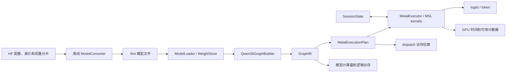

# Qwen3.5-4B Metal 推理引擎架构设计

## 1. 首版目标

在 Apple Silicon 上以 batch 1 运行 Qwen3.5-4B 的纯文本自回归推理，覆盖文本主干从 token ID 到 logits 的全部算子。首版采用 **W8A8**。所有线性投影使用离线 INT8 权重和运行时动态量化的 INT8 输入，每组点积使用 INT32 累加，乘回 scale 后在 FP32 合并各组结果。投影输出和层间激活使用 FP16，卷积、注意力和 KV cache 保持浮点路径，归约与 DeltaNet 递归状态使用 FP32。引擎接口接收 token ID，生成循环和采样策略放在 C++ 主机层。Tokenizer、chat template 和交互 CLI 可在 token ID 链路通过后接入。

本地检查点还包含视觉塔及 MTP 权重。首版转换时将它们记录为已知的跳过项。若后续需要图像或视频输入，再补视觉预处理、patch embedding、视觉 attention/MLP、patch merger 及三轴位置输入。MTP 可独立作为推测解码扩展。首版上下文验收目标为 4096 token，运行时根据设备预算配置上限。

## 2. 组件和数据流



| 建议目录 | 职责 |
| --- | --- |
| `tools/modelconverter/` | 读取 HF 索引和 safetensors，校验、量化、打包 |
| `lib/ModelFormat/` | 共享容器读写、模型配置、tensor ID 和布局定义 |
| `lib/Models/Qwen35/` | 根据配置和权重 ID 构建文本图及各层状态规格 |
| `lib/GraphIR/` | 类型、形状、算子语义、状态依赖、图验证和逻辑成本 |
| `lib/Runtime/` | 模型和会话生命周期、prefill/decode 调度、采样和统计输出 |
| `lib/Backend/Metal/` | 图降级、缓冲区规划、pipeline 缓存、命令编码及 `Kernels/*.metal` |
| `tests/` | 文件格式、GraphIR、算子、模型对拍及性能基准 |

主体采用 C++17 和 CMake。CMake 将 C++ 和 Objective-C++ 目标的语言标准设为 17。Metal API 封装在 Objective-C++ `.mm` 内，GPU 算子使用 MSL。公开 C++ 接口和 GraphIR 保持平台独立，沿用仓库约定的 MLIR 代码风格。首版以小型强类型 C++ IR 实现，Python 用于生成参考结果和对拍。

## 3. ModelConverter 与 `.llmi`

1. 读取 `config.json` 和 `model.safetensors.index.json`。按索引定位分片，校验必需张量的名称、形状、dtype、偏移和长度。逐张量分块转换，以行块为单位控制峰值内存。
2. 将 HF 名称映射为稳定的 `TensorId`，由转换器和建图器共享 schema。按 `layer_types` 生成预期权重清单。本地检查点没有单独的 `lm_head.weight`，文件中保留一份 `embed_tokens.weight`，供 embedding gather 和输出投影共同引用。对无法识别的文本权重或不受支持的模型变体报错。
3. 所有线性投影（包括 `in_proj_a/b`）的权重采用逐输出行、沿输入维 K 每 32 个元素一组的对称量化。`scale` 使用 FP16 保存，量化时使用同一已舍入的 scale。卷积权重使用 FP16。Norm 权重、`A_log` 和 `dt_bias` 保留为 FP32。可用同一容器保存未量化的 FP16 矩阵作为对拍路径。
4. 写临时文件，校验目录和 payload 后原子替换目标。记录源配置、量化版本、各 dtype 大小和跳过项。Tokenizer 和模板保留为 HF 原始旁车文件，由接入层读取。

```text
maxAbs = max(abs(w))                # FP32，组内权重
scale  = fp16(max(maxAbs / 127, 2^-14))  # 非零组
q      = clamp(roundEven(w / fp32(scale)), -127, 127)
w_hat  = fp32(q) * fp32(scale)
```

全零组使用 `scale=1, q=0`，尾组补零，非有限权重和转换后溢出均报错。`RowMajorI8Group32` 的字节布局为连续 `int8[N, Kpad]` 和独立的 `fp16[N, Kpad/32]` scale 区，其中 `Kpad=32×ceil(K/32)`。Embedding 只解量化所选行。后续 tile packing 使用独立 `layoutId`。

`.llmi` v1 使用固定小端编码，文件布局如下。

| 区域 | 编码 |
| --- | --- |
| 文件头 | 72 字节。依次为 8 字节 magic（十六进制 `4c 4c 4d 49 0d 0a 1a 0a`）、32 位格式版本和架构 ID、6 个 64 位字段（manifest 偏移和长度、目录偏移和条数、payload 偏移和长度）、32 位 CRC32 和 32 位保留零。CRC32 覆盖文件头之后的全部字节。 |
| Manifest | UTF-8 JSON，记录原始配置、权重量化规格、跳过的张量和 `lm_head.weight` 别名。 |
| Tensor 目录 | 每条 192 字节，按 `TensorId` 排序。依次为 96 字节零填充 ID、4 个 32 位字段（dtype、layout、rank、保留零）、逻辑形状和存储形状各 3 个 64 位维度（未使用项为零）、数据及 scale 各自的 64 位偏移和长度。 |
| Payload | 按目录顺序存放数据及 scale。目录、各数据区和 scale 区的起点按 64 字节对齐，空隙填零。动态激活及其 scale 由 GPU 在运行时生成，存放于临时 arena。 |

Loader 根据 manifest 重建预期张量目录并逐条验证，从而拒绝与模型配置不一致的形状、类型、范围重叠和无效偏移，再检查 CRC32。C++ `ModelFile` 通过 `getTensor` 解析别名，并提供按已验证区间读取数据的接口。

Loader 提供 `splitRows`，按设备 `maxBufferLength` 返回数据和 scale 的完整行区间。Metal 执行计划可据此拆分 buffer，把输出投影分片写入同一个逻辑 logits 向量，并按 token ID 定位 embedding 行。当前加载器按区间读取文件。后续可按设备要求评估映射和 `bytesNoCopy`，映射生命周期需覆盖所有使用它的 GPU 工作。[Apple Metal buffer 上限](https://developer.apple.com/documentation/metal/mtldevice/maxbufferlength) · [Apple Metal 无拷贝 buffer](https://developer.apple.com/documentation/metal/mtldevice/makebuffer%28bytesnocopy%3Alength%3Aoptions%3Adeallocator%3A%29) · [Safetensors 格式](https://github.com/safetensors/safetensors#format)

## 4. 文本图与 Metal 算子

### W8A8 投影

`QuantizeActivation` 对每个 token 沿 K 每 32 个元素单独做动态对称量化，与权重分组对齐。每组用 FP32 求绝对值最大值，`sA=max(abs(x))/127`，`qA=clamp(roundEven(x/sA), -127, 127)`。全零组使用 `sA=1, qA=0`，尾组补零。对 `[T,K]` 输入，输出 `int8[T,Kpad]` 和 `fp32[T,Kpad/32]`。动态 scale 无需离线校准数据，prefill 和 decode 使用同一规则。

```text
partial[t,n,g] = sum_k_in_g(int32(qA[t,k]) * int32(qW[n,k]))
y[t,n] = fp16(sum_g(fp32(partial[t,n,g]) * sA[t,g] * fp32(sW[n,g])))
```

每组 INT32 点积的绝对值上界为 `32×127²=516,128`。各组 scale 不同，必须按组乘回 scale 后再做 FP32 求和。Metal 基线将 INT8 向量加载后拓宽为 INT32，做整数乘加和归约。分别实现 decode 的 GEMV 与 prefill 的分块 GEMM 变体。原生低精度指令的可用性和收益按目标设备实测，基线依赖通用整数运算。[Apple Metal 类型](https://developer.apple.com/documentation/metal/mtldatatype) · [Apple SIMD 执行宽度](https://developer.apple.com/documentation/apple-silicon/porting-your-metal-code-to-apple-silicon)

### 模型算子与状态

本地 `config.json` 和分片头部确认文本主干有 32 层、24 层 Gated DeltaNet 和 8 层 Gated GQA。`hidden_size=2560`，MLP 中间维度为 9216，词表大小为 248320。建图顺序直接来自 `layer_types`。每层先经过 RMSNorm、token mixer 和残差相加，再经过 RMSNorm、SwiGLU MLP 和残差相加。模型尾部为最终 RMSNorm 和共享权重的输出投影。[官方配置](https://huggingface.co/Qwen/Qwen3.5-4B/blob/main/config.json) · [Transformers 参考实现](https://github.com/huggingface/transformers/blob/main/src/transformers/models/qwen3_5/modeling_qwen3_5.py)

| 子图 | Metal 算子与语义 |
| --- | --- |
| 公共算子 | `EmbeddingGather`、`QuantizeActivation`、`LinearW8A8`、`RmsNorm`、`Add`、`SiluMul`、`SigmoidMul`，以及对拍用的 `LinearF16`。普通 Qwen RMSNorm 乘 `(1 + weight)`。支持 reshape/slice 视图，布局不兼容时由后端插入拷贝。 |
| Gated GQA | `q_proj` 输出 8192 维，先 reshape 为 `[T,16,2×256]` 再按 head 拆 Q 和 gate。K/V 各 4 个 head，head dim 为 256。对 Q/K 做 head-wise RMSNorm，按绝对位置应用前 64 维的 partial RoPE，文本三个轴使用相同的位置。写入旋转后的 K 和原 V，再做 causal GQA，softmax 使用 FP32。输出乘 `sigmoid(gate)` 后过 `o_proj`。 |
| Gated DeltaNet | `in_proj_qkv` 输出 8192 维，做窗口为 4 的逐通道因果卷积及 SiLU，再拆为 Q/K/V。Q/K 各 16 个 head，V 有 32 个 head，head dim 均为 128。Q/K 做 L2Norm，Q 额外乘 `1/sqrt(128)`，每两个 V head 共享一个 Q/K head。`in_proj_a/b` 生成衰减和更新门，`in_proj_z` 生成输出门。`DeltaUpdate` 更新 FP32 状态，随后执行 `GatedRmsNorm` 和 `out_proj`。此处 norm 直接乘 `weight`，再乘 `SiLU(z)`。 |
| 输出 | 对选定位置做最终 RMSNorm、`QuantizeActivation` 和 `LinearW8A8`。默认 prefill 仅投影最后一个有效 token，对拍模式可请求全部位置。首版由 CPU 读取 logits 并采样，可用 GPU argmax 单独优化贪心路径。 |

DeltaNet 按 value head 保存逻辑形状 `[128,128]` 的状态矩阵 `S`。令 `q` 为归一化并缩放后的 Q，`k` 为归一化后的 K，逐 token 执行：

```text
beta  = sigmoid(b)
g     = -exp(A_log) * softplus(a + dt_bias)
S0    = exp(g) * S
delta = beta * (v - kᵀ S0)
S1    = S0 + k ⊗ delta
y     = qᵀ S1
```

卷积只需保存最近 3 个**卷积前**的 QKV 向量。首版 prefill 采用分块投影和逐 token 递归，可用单个 dispatch 按 head 和 V 维分 tile，并在 tile 内保持时间顺序。decode 复用单步递归。GQA prefill 和 decode 可先共享在线 softmax 实现，按 query/head 扫描有效的 K/V，避免分配 `T×T` 中间结果。优化阶段再引入 tiled prefill、长上下文分段归约和 chunked DeltaNet。

## 5. GraphIR、执行计划与会话状态

**GraphIR** 是有序 SSA 数据流。`ValueDesc` 包含 dtype、逻辑形状和布局约束，`Op` 包含类型、输入输出、强类型属性和 layer ID。权重使用 `TensorId`，运行时维度只包含输入 token 数 `T` 和已有前缀 `P`。对 `KvAppend`、`CausalConv1d` 和 `DeltaUpdate` 显式记录状态 slot 及读写范围或状态版本。图验证器检查 dtype、shape、use-def、别名和状态顺序。`Qwen35GraphBuilder` 负责将模型算子编码进 GraphIR。

`QuantizeActivation` 产生一对 SSA 值，分别表示 INT8 数据和 FP32 scale。`LinearW8A8` 显式消费这对值及量化权重，验证器检查逻辑 K、分组大小和 scale 形状。共享同一输入的 Q/K/V、DeltaNet 的 qkv/z/a/b、MLP 的 gate/up 各复用一次量化，输入不同的输出投影和 down 投影单独量化。Metal 后端可融合 norm 与量化，或在 GEMM tile 内量化。只有在融合后实际省去全局缓冲区访问时，执行成本才扣除相应流量。

**MetalExecutionPlan** 将验证后的图绑定到 kernel 和缓冲区。降级阶段选择 kernel 变体、确定 dispatch 几何和依赖、规划临时 arena，并保留每条 dispatch 对应的 GraphIR op ID。prefill 以 `T` 桶复用计划，decode 使用 `T=1`，`P`、有效 `T` 和实际写入位置随调用绑定。计划缓存包含模型布局版本、设备能力和形状桶，逻辑成本按实际长度计算，padding 仅进入执行成本。

**MetalExecutor** 将执行计划编码成 `MTLComputeCommandEncoder` 命令，管理 pipeline cache、buffer 绑定和同步。首版每个 prefill chunk 或 decode step 提交一个 command buffer，按依赖插入需要的 buffer 屏障或拆分 encoder。临时 arena 只在上一个使用者完成且依赖得到保证后复用。CPU 只在需要结果或处理失败时等待，无需逐算子同步。[Apple Metal compute encoder](https://developer.apple.com/documentation/metal/mtlcomputecommandencoder/)

**SessionState** 独立持有可变状态，多个 session 可共享只读权重和执行计划。首版每个 session 只允许一个在途 step。进入 step 前校验容量，成功完成后才提交已处理长度 `P`。GPU 执行失败后使 session 失效并要求重置或用 token 历史重建，因为状态可能已经部分写入。

主机接口可收敛为 `Engine::load(path)`、`Engine::createSession(capacity)`、`Session::prefill(tokenIds)` 和 `Session::decode(tokenId)`。后两者复用内部 `runStep(tokenIds, logitsMode)`。调用方消费当前 logits、选出下一个 token，再把它传入 `decode`。prefill 内部 chunk 可以跳过 logits 投影，但仍更新三类会话状态。

| 状态 | 首版布局和容量，batch 1 |
| --- | --- |
| GQA KV cache | 每层 K/V 分开，逻辑形状各为 `[capacity,4,256]`，FP16。8 层合计每个缓存 token 32 KiB。4096 token 占 128 MiB。可按连续 token 段扩容，容量和有效长度分开。 |
| DeltaNet 递归状态 | 每层 `[32,128,128]` FP32，共 48 MiB。可按 V 维分 tile，物理布局由 Metal 后端选择。 |
| DeltaNet 卷积历史 | 每层 `3×8192` 个 FP16 元素，共 1.125 MiB。首 token 左侧补零，跨 chunk 延续历史。 |

按本地张量形状计算，所有 W8 投影权重、共享 embedding 和 scale 约占 **4.47 GB**，另计其他浮点权重、对齐、临时区和运行时状态。配置的 262144 token 仅 KV cache 就需要 8 GiB。加载时按实际设备的单 buffer 限制和工作集预算计算可用容量，并把活跃 KV、已分配 KV 和临时 arena 峰值分别报告。[Apple Metal 工作集预算](https://developer.apple.com/documentation/metal/mtldevice/recommendedmaxworkingsetsize?changes=__1)

## 6. 计算量、访存量和性能报告

| 口径 | 来源 | 输出 |
| --- | --- | --- |
| 模型语义成本 | GraphIR 每个算子的 shape 和状态访问描述 | `macs`、普通标量运算数、特殊函数次数、逻辑读写字节。算子内每个逻辑区域按使用范围计一次，跨算子分别计读写。 |
| 执行计划估算 | Metal kernel 变体、dispatch 几何、实际存储布局 | `estimatedGlobalReadBytes` 和 `estimatedGlobalWriteBytes`，按 tile 访问模型计入 padding、scale、工作组重复读取、状态写回、临时区和拷贝。融合消除的中间读写从此处移除。缺少模型的 dispatch 标记为未知。 |
| GPU 实测 | Command buffer 时间戳和设备支持的 Metal 计数器 | GPU 时间及可用硬件指标。实际 DRAM 字节仅在有对应计数器时提供，其他设备标记为不可用。按需开启 dispatch 采样，避免采样影响常规性能基准。 |

典型算子的计数规则如下。`T` 是本次实际 token 数，`P` 是已有前缀长度，`L=P+T`，`G=ceil(K/32)`。

- `QuantizeActivation(T×K)` 逻辑读 `2×T×K` 字节 FP16 输入，逻辑写 `T×K + 4×T×G` 字节 INT8 数据与 FP32 scale。绝对值、最大值归约、scale 计算、舍入和截断计入各自的运算项。共享量化结果只计一次写出，各消费者分别计读取。
- `LinearW8A8(T×K, N×K)` 为 `T×N×K` INT8 MAC。逻辑读量包括 `T×K + 4×T×G` 字节激活及其 scale、`N×K + 2×N×G` 字节权重及其 scale。逻辑写量为 `2×T×N` 字节 FP16 输出。另计 FP32 分组缩放和合并，执行估算计入 `Kpad` 和各 tile 的读取次数。输出投影及其量化将 `T` 换成实际请求的 logits 行数。
- Causal GQA 的有效 query/key 对数为 `T×P + T×(T+1)/2`。QK 与 AV 合计 `2×16×256×有效对数` MAC。每层 attention 的逻辑 K/V 读取为 `2×L×4×256×2` 字节，另计 `KvAppend` 写入的 `T` 行。执行估算按 kernel 对 KV 的实际复用方式计数。
- DeltaNet 单步的两次向量矩阵乘与一次秩一更新，合计每层 `3×32×128×128` MAC。状态衰减、`delta` 的减乘、L2Norm 及门控另计。单步跨 24 层的 FP32 递归状态逻辑读写合计 96 MiB。若 prefill 算子在一次调用内处理 `T` 个 token，逻辑上读写入口和出口状态各一次，执行估算记录 kernel 是否在中途写回。
- 报告分别列出 `int8Macs` 和 `fpMacs`，可用 `2×MAC` 展示乘加对应的等价标量运算数。动态量化、分组缩放及 `exp`、`rsqrt` 等运算单独统计。

`--profile=summary|op` 建议同时输出人读摘要和 JSON，包含 phase、layer、op、实际形状、读写分类（权重、激活、KV、递归状态、临时区）、GPU 时间、TTFT 和 decode tok/s。TTFT 定义为提交请求到得到第一个生成 token 的端到端时间。容量字段单独列出，避免与累计访问字节混用。[Apple Metal GPU 计数器采样](https://developer.apple.com/documentation/metal/sampling-gpu-data-into-counter-sample-buffers?language=objc)

## 7. 实施和验收顺序

1. **格式与量化**。完成 converter、loader 和 `.llmi` inspect。验证本地两分片可转换，embedding/head 共享同一数据，损坏文件可拒绝，重复转换输出一致。用小张量校验权重量化、尾组、全零组和行分片边界。
2. **算子与参考图**。先用未量化 FP16 载荷跑通 embedding、SwiGLU、一个 DeltaNet block 和一个 GQA block。用固定版本的 Transformers 生成参考，逐项对拍卷积历史、递归状态、旋转后的 K、残差和 logits。给缩小配置建立快速测试，覆盖 chunk 边界、单 token 和非整 tile。
3. **整模与 W8A8**。用 CPU 参考逐项验证 `qA`、scale、INT32 分组点积与输出，覆盖全零组、离群值、舍入边界及不同 scale 的多组输入。再对拍一次 prefill、分块 prefill、逐 token 推进和后续多步 decode。验证 session reset。分开测量 FP16 Metal 对 Transformers 的误差，以及 W8A8 对 FP16 Metal 的误差，特别检查 DeltaNet 的门控投影和长序列状态漂移。使用固定 token 序列比较 logits、top-k 和困惑度，阈值在获得基线后确定。
4. **成本和性能**。用可手算的小图验证统计公式、量化复用和融合前后的访问量。在实际设备上记录短 prompt、4096 token prefill 和多步 decode 的耗时、动态量化开销、访问估算及峰值内存。以基准判断优先优化 INT8 GEMV/GEMM、融合量化或 chunked DeltaNet。
